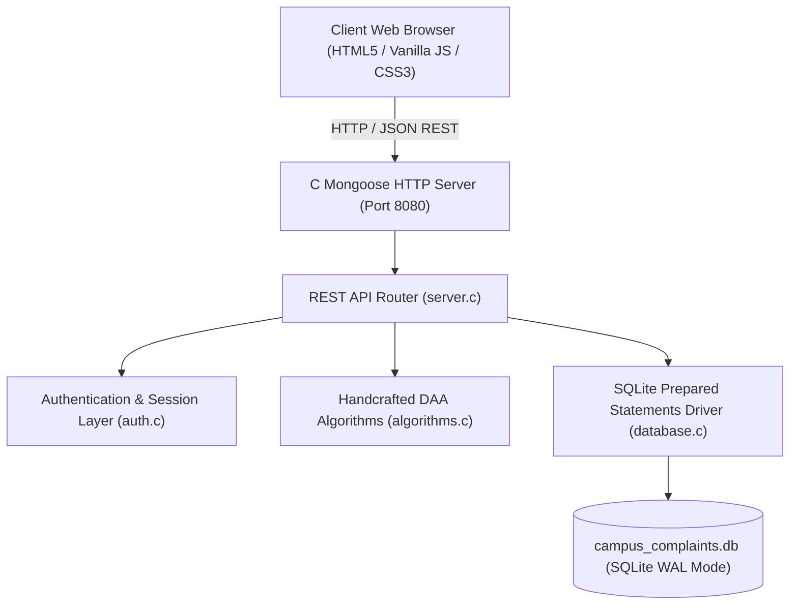
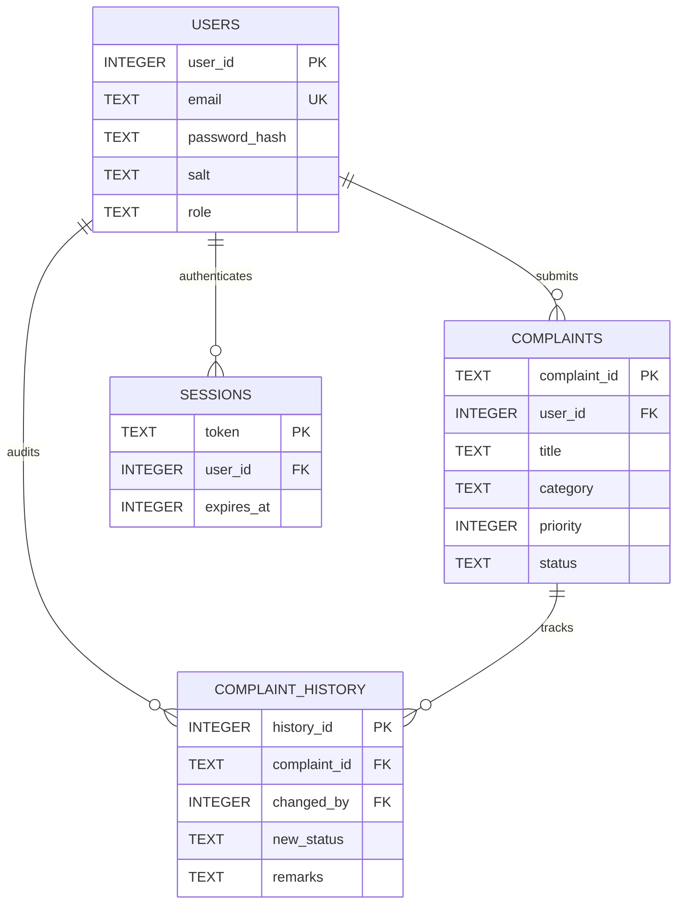

# Campus Complaint Tracker — Full-Stack DAA Web Application


---

## 1. Abstract
The **Campus Complaint Tracker** is a full-stack, enterprise-grade academic web application designed for collegiate campus facility grievance management. Built specifically for academic **Design and Analysis of Algorithms (DAA)** evaluation, the core backend logic, relational data access, and core algorithmic procedures are implemented natively in the **C programming language**. The system solves campus facility delays by combining handcrafted sorting and priority scheduling algorithms with persistent SQLite database storage and a modern 3D glassmorphism dark-mode web interface.

---

## 2. Problem Statement
Traditional university campus grievance mechanisms rely on physical paper complaint logs, unindexed spreadsheets, or opaque internal email threads. This introduces four systemic problems:
1. **Unprioritized Resolution**: Hazardous emergencies (e.g. electrical short circuits, water line bursts) get lost in a flat queue behind trivial routine complaints.
2. **Zero Audit Transparency**: Students receive no receipt, no deterministic tracking ID, and no visibility into administrative remarks or technician assignments.
3. **Inefficient Search and Retrieval**: Searching through thousands of historical complaints in unindexed systems degrades to linear scans ($O(N)$).
4. **Lack of Provable Algorithmic Guarantees**: Generic web frameworks hide algorithmic complexities beneath high-level abstractions, leaving students unable to measure empirical computational efficiency.

---

## 3. Primary Objectives
1. **Provable DAA Algorithms**: Handcraft Merge Sort, Binary Search, and a Max-Heap Priority Queue in pure C99 with sub-microsecond hardware benchmarking (`QueryPerformanceCounter`).
2. **Deterministic Priority Scheduling**: Implement an automated Max-Heap priority queue where Critical (P4) emergencies bubble to the root in $O(1)$ peek time.
3. **Persistent Relational Ledger**: Maintain foreign key integrity, ACID transactions, and cold-reboot persistence in SQLite.
4. **Role-Based Security**: Provide separate, authenticated student and administrator dashboards with cryptographically stretched password hashing and HttpOnly session cookies.
5. **Interactive Faculty Demonstration**: Offer a dedicated DAA Lab page where professors can benchmark and compare algorithms on live datasets up to 5,000 items.

---

## 4. Scope & Capabilities
- **Public Portal**: Modern landing page with interactive 3D perspective cards and live aggregate facility statistics.
- **Student Dashboard**: Submit facility complaints with categories (Hostel, Labs, Electricity, Wi-Fi, etc.), track real-time status timelines, and receive unique tracking IDs (`CMP-YYYY-XXXX`).
- **Administrator Console**: Triage complaints, modify authoritative priorities, assign maintenance teams, append remarks, review dynamic Chart.js analytics, and export authorized records to CSV.
- **DAA Algorithm Laboratory**: Real-time benchmarking sandbox displaying measured microsecond durations, comparisons, movements, and theoretical vs. empirical Big-O scaling.

---

## 5. Technology Stack

### Backend
- **Language**: C (C99 standard)
- **HTTP Server**: Mongoose Embedded C Network Engine (v7.14)
- **Database Engine**: SQLite 3.53.3 C API (`sqlite3.h`, `sqlite3.c`)
- **JSON Parser & Serializer**: `cJSON` in ANSI C
- **Cryptography**: 5,000-round iterated salted SHA-256 key stretching, Windows CryptoAPI (`CryptGenRandom`)
- **Networking**: Windows Sockets 2 (`ws2_32`)

### Frontend
- **Structure**: Semantic HTML5 with ARIA accessibility
- **Styling**: Vanilla CSS3 (Custom Dark Cinematic Design System, Glassmorphism, 3D CSS Transforms)
- **Scripting**: Vanilla JavaScript (ES6+ modular API client)
- **Visualizations**: Chart.js for responsive doughnut, bar, and line graphs
- **Icons**: Crisp inline SVG icon system

---

## 6. System Architecture



---

## 7. Database Entity-Relationship Model



---

## 8. DAA Algorithm Specifications

### Complexity Matrix

| Algorithm | Role in Application | Best Case | Average Case | Worst Case | Auxiliary Space |
| :--- | :--- | :--- | :--- | :--- | :--- |
| **Algorithm A: Merge Sort** | Multi-key sorting (Priority, Date, ID) | $\Theta(n \log n)$ | $\Theta(n \log n)$ | $\Theta(n \log n)$ | $O(n)$ |
| **Algorithm B: Binary Search** | Fast lookup by unique Complaint ID | $\Theta(1)$ | $\Theta(\log n)$ | $\Theta(\log n)$ | $O(1)$ |
| **Algorithm C: Max-Heap (Insert)** | Priority queue insertion | $\Theta(1)$ | $\Theta(\log n)$ | $\Theta(\log n)$ | $O(1)$ |
| **Algorithm C: Max-Heap (Extract)** | Dispatch highest priority issue | $\Theta(\log n)$ | $\Theta(\log n)$ | $\Theta(\log n)$ | $O(1)$ |
| **Algorithm C: Max-Heap (Floyd Build)** | Linear rebuild from database records | $\Theta(n)$ | $\Theta(n)$ | $\Theta(n)$ | $O(1)$ |
| **Algorithm D: Linear Search** | Baseline scan for comparison | $\Theta(1)$ | $\Theta(n)$ | $\Theta(n)$ | $O(1)$ |
| **Algorithm E: SQLite B-Tree Index**| On-disk index retrieval | $\Theta(1)$ | $\Theta(\log n)$ | $\Theta(\log n)$ | $O(1)$ |

### Merge Sort Recurrence Derivation
$$T(n) = 2T(n/2) + \Theta(n), \quad T(1) = \Theta(1)$$
By Case 2 of the Master Theorem:
$$a = 2, \quad b = 2, \quad \log_2 2 = 1 \implies T(n) = \Theta(n \log n)$$

### Floyd's Linear Heap Build Proof
$$\sum_{h=0}^{\lfloor\log_2 n\rfloor} \left\lceil \frac{n}{2^{h+1}} \right\rceil O(h) \le \frac{n}{2} \sum_{h=0}^{\infty} \frac{h}{2^h} = \frac{n}{2} (2) = \Theta(n)$$

---

## 9. Project Directory Structure

```
DAA_project/
├── backend/
│   ├── include/
│   │   ├── algorithms.h        # DAA data structures, comparators & prototypes
│   │   ├── auth.h              # Salted SHA-256 & crypto session prototypes
│   │   ├── cJSON.h             # JSON parser header
│   │   ├── common.h            # Shared models: User, Complaint, History
│   │   ├── database.h          # SQLite prepared statements API
│   │   └── server.h            # HTTP server configuration
│   ├── lib/
│   │   ├── mongoose.c          # Mongoose embedded C HTTP server
│   │   ├── mongoose.h          # Mongoose header (v7.14)
│   │   └── mongoose.o          # Compiled object
│   ├── src/
│   │   ├── algorithms.c        # Handcrafted Merge Sort, Binary Search, Max-Heap
│   │   ├── auth.c              # RFC 6234 SHA-256, salt generation, rate limiting
│   │   ├── cJSON.c             # ANSI C JSON serializer and parser
│   │   ├── database.c          # SQLite prepared queries, transactions, seed data
│   │   ├── main.c              # Application entrypoint & CLI argument parser
│   │   └── server.c            # REST API router & static asset dispatcher
│   └── tests/
│       ├── test_algorithms.c   # Unit test suite (104 assertions)
│       └── test_api.c          # Integration & persistence test suite (30 assertions)
├── database/
│   └── schema.sql              # Clean SQL schema with foreign keys and indexes
├── docs/
│   ├── api-documentation.md    # Complete REST API specification
│   ├── architecture.md         # Full system architecture & sequence diagrams
│   ├── daa-analysis.md         # Rigorous mathematical algorithm analysis
│   ├── database-design.md      # Relational database & ER specifications
│   └── testing.md              # Test execution methodology & results
├── public/                     # Frontend Assets & Web Pages
│   ├── css/
│   │   ├── dashboard.css       # Student & Admin dashboard layouts
│   │   ├── landing.css         # 3D isometric perspective hero styles
│   │   └── main.css            # Dark cinematic design system & global styles
│   ├── js/
│   │   ├── admin.js            # Admin controller (triage, status, CSV export)
│   │   ├── api.js              # Central API client & toast notification manager
│   │   ├── auth.js             # Authentication form controller
│   │   ├── chart.umd.min.js    # Chart.js library for offline evaluation
│   │   ├── daa-lab.js          # Interactive live C benchmark runner
│   │   └── student.js          # Student portal controller (submit & filter)
│   ├── admin.html              # Administrator dashboard interface
│   ├── auth.html               # Authentication portal (Sign In / Register / Reset)
│   ├── daa-lab.html            # DAA Algorithm Laboratory & benchmarks
│   ├── index.html              # Public landing page
│   └── student.html            # Student dashboard interface
├── build.ps1                   # Automated PowerShell build and test script
├── Makefile                    # Standard GNU Makefile
└── README.md                   # Complete academic documentation
```

---

## 10. Installation & Launch Instructions (Windows)

### Prerequisites
1. **GCC Compiler**: Modern 64-bit MinGW-w64 or MSYS2 UCRT64 GCC (already detected on machine at `C:\msys64\ucrt64\bin\gcc.exe`).
2. **PowerShell**: Windows PowerShell (built into Windows).

### Step 1: Compile & Test in One Command
Open PowerShell in the project directory and run:
```powershell
.\build.ps1 -Action all
```
This will:
- Compile the Mongoose embedded network engine.
- Compile the C backend executable (`campus_server.exe`).
- Run the DAA algorithm unit tests (104 assertions).
- Run the SQLite backend integration tests (30 assertions).

### Step 2: Launch the Web Application
```powershell
.\campus_server.exe --port 8080
```
Output:
```
=======================================================
   CAMPUS COMPLAINT TRACKER - FULL-STACK DAA SERVER    
=======================================================
   * Server running on: http://localhost:8080
   * Web Root:          public
   * SQLite DB:         campus_complaints.db
   * Admin Account:     admin@campus.edu (Admin@123)
   * Demo Students:     student1@campus.edu (Student@123)
                        student2@campus.edu (Student@123)
=======================================================
```

### Step 3: Open in Browser
Visit **`http://localhost:8080`** in your browser.

---

## 11. Demonstration Accounts (Evaluation Ready)

| Role | Email | Password | Pre-seeded Activity |
| :--- | :--- | :--- | :--- |
| **Administrator** | `admin@campus.edu` | `Admin@123` | Full access to all campus complaints, priority triage, remarks, analytics, CSV export |
| **Student 1 (Aarav)** | `student1@campus.edu` | `Student@123` | Active complaints across Hostel, Electricity, and Canteen |
| **Student 2 (Priya)** | `student2@campus.edu` | `Student@123` | Active complaints across Wi-Fi, Laboratories, and Classrooms |

> **Faculty Tip**: On the `/auth.html` page, click any of the **Quick-Fill** chips to auto-fill credentials for instantaneous login!

---

## 12. Verification & Test Results

```
==================================================
 CAMPUS COMPLAINT TRACKER - DAA TEST SUITE 
==================================================
--> Testing Merge Sort...
   [PASS] Merge Sort passed all assertions!
--> Testing Binary Search...
   [PASS] Binary Search passed all assertions!
--> Testing Max-Heap Priority Queue...
   [PASS] Max-Heap passed all assertions!

==================================================
 RESULTS: 104 / 104 tests passed successfully! 
==================================================

==================================================
 CAMPUS COMPLAINT TRACKER - BACKEND INTEGRATION 
==================================================
[DB] Initial Administrator created: admin@campus.edu (ID: 1)

==================================================
 RESULTS: 30 / 30 integration tests passed! 
==================================================
```

---

## 13. Limitations & Future Enhancements
1. **Multi-Campus Scaling**: Migrate from single-instance SQLite WAL mode to distributed SQLite (e.g. LiteFS) for multi-node university clusters.
2. **Automated AI Triage**: Integrate lightweight on-premise NLP embeddings to suggest complaint category and department routing.
3. **SMS / Push Notifications**: Integrate WebPush API for real-time mobile push notifications when ticket status changes.
