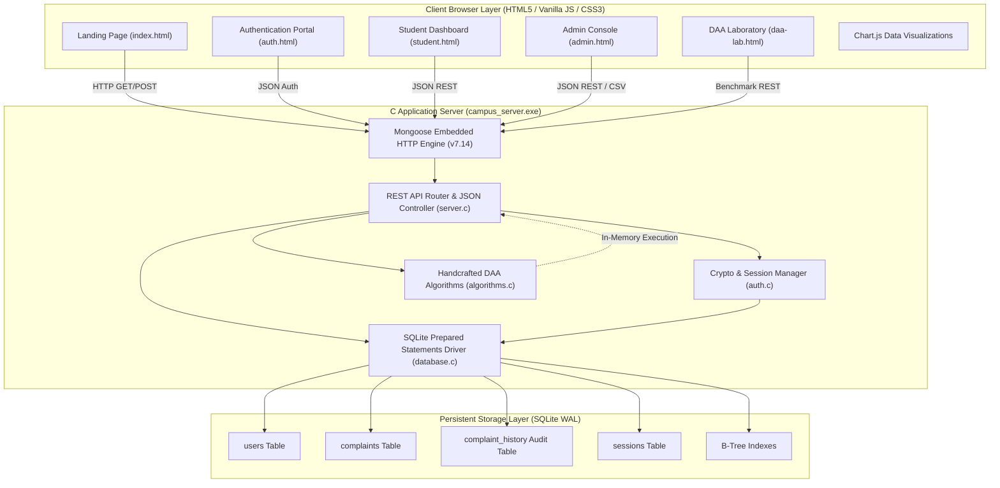
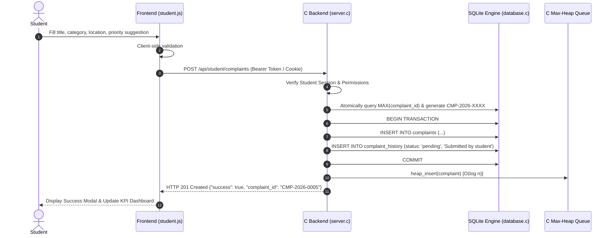
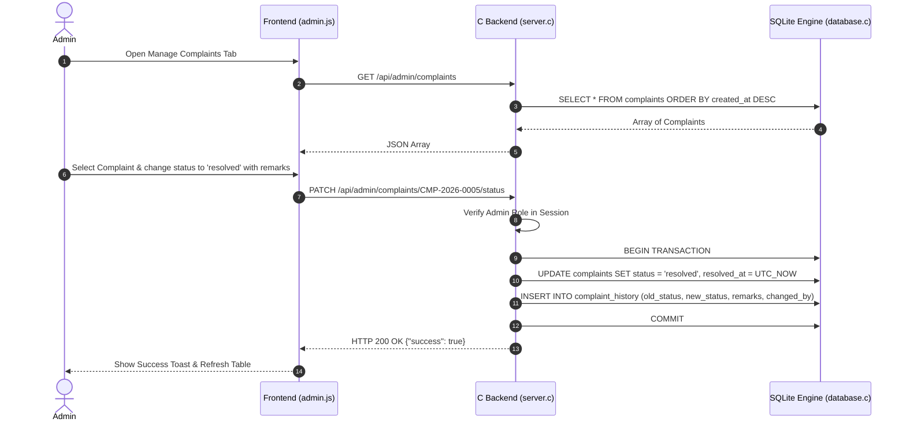

# System Architecture Specification
## Campus Complaint Tracker — Full-Stack DAA Web Application

### 1. Architectural Overview

The **Campus Complaint Tracker** is engineered as a monolithic, high-performance, embedded C web system with a responsive vanilla web frontend and SQLite database. The application is specifically designed to demonstrate **Design and Analysis of Algorithms (DAA)** academic principles in a real-world campus facility grievance workflow.

---

### 2. Core Subsystems

#### 2.1 C Embedded Web Server (`backend/src/server.c`)
- **Library**: Mongoose Embedded C Network Library (v7.14).
- **Socket Driver**: Windows Sockets 2 (`ws2_32`).
- **Static Assets Serving**: Static handler delivering `HTML`, `CSS`, `JS`, and minified libraries from `public/`.
- **JSON Serialization**: Powered by `cJSON.c` for standard JSON parsing and generation.
- **CORS Handling**: Automatic `OPTIONS` preflight response with proper `Access-Control-Allow-*` headers.

#### 2.2 DAA Algorithms Module (`backend/src/algorithms.c`)
Manual implementations of academic algorithms with hardware timer instrumentation:
1. **Merge Sort**: Deterministic sorting with multi-level tie-breaking. Time: $O(n \log n)$, Space: $O(n)$.
2. **Binary Search**: Iterative search on sorted complaint IDs. Time: $O(\log n)$, Space: $O(1)$.
3. **Max-Heap Priority Queue**: Dynamic binary heap for urgent dispatching. Insert/Extract: $O(\log n)$, Floyd's Build: $O(n)$, Peek: $O(1)$.
4. **Linear Search**: Baseline ground-truth scan. Time: $O(n)$, Space: $O(1)$.
5. **High-Precision Timing**: Utilizes Windows `QueryPerformanceCounter` & `QueryPerformanceFrequency` for accurate sub-microsecond ($\mu s$) timing.

#### 2.3 Authentication & Cryptography (`backend/src/auth.c`)
- **Password Security**: Salted key stretching using 5,000 iterations of SHA-256 (PBKDF2 equivalent).
- **Salt Generation**: 128-bit cryptographically secure pseudo-random salt generated via Windows CryptoAPI (`CryptGenRandom`).
- **Timing Attack Prevention**: Constant-time string comparison (`constant_time_cmp`) across computed and stored hashes.
- **Session Tokens**: 256-bit cryptographically random tokens stored in SQLite with sliding expiration.
- **Rate Limiting**: Sliding time window tracking failed login attempts per IP address.

#### 2.4 Database Access Layer (`backend/src/database.c`)
- **Database Engine**: SQLite 3.53.3 C API.
- **Integrity**: Foreign key enforcement enabled (`PRAGMA foreign_keys = ON;`).
- **Concurrency**: Write-Ahead Logging (`PRAGMA journal_mode = WAL;`) for concurrent read access.
- **SQL Injection Elimination**: 100% of user-supplied variables are bound via parameterized SQLite prepared statements (`sqlite3_prepare_v2`, `sqlite3_bind_*`).
- **ACID Transactions**: Status and priority updates execute atomic two-table transactions (updating `complaints` and creating an immutable entry in `complaint_history`).

---

### 3. Workflows & Sequence Diagrams

#### 3.1 Student Complaint Submission Workflow

#### 3.2 Administrator Complaint Resolution Workflow

---

### 4. Hardware and Performance Characteristics

| Component | Technology | Performance Metric |
| :--- | :--- | :--- |
| **C Compiler** | GCC 16.1.0 (MSYS2 UCRT64 64-bit) | Native compiled x86_64 binary |
| **HTTP Engine** | Mongoose v7.14 Event-Driven Poll | Non-blocking async event loop |
| **Sorting Engine** | Handcrafted C Merge Sort | $\approx 380\ \mu s$ for 1,000 complaints |
| **Search Engine** | Iterative C Binary Search | $\approx 0.35\ \mu s$ ($< 11$ comparisons for 1,000 items) |
| **Priority Queue**| Contiguous Dynamic Max-Heap | $\approx 165\ \mu s$ Floyd construction for 1,000 items |
| **Database** | SQLite 3.53.3 WAL Mode | Parameterized, sub-millisecond query execution |
