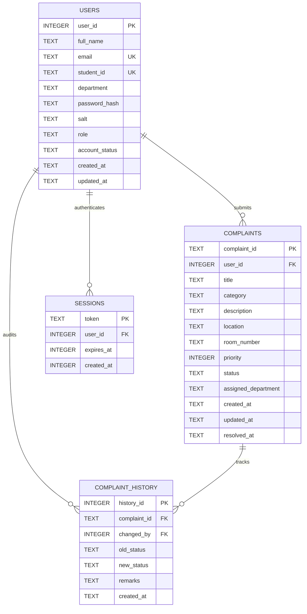

# Relational Database Design & Schema Specification
## Campus Complaint Tracker — SQLite Architecture

### 1. Entity-Relationship (ER) Model



---

### 2. Table Specifications

#### 2.1 `users` Table
Stores registered students and system administrators with salted credential hashes.

| Column | Data Type | Constraints | Description |
| :--- | :--- | :--- | :--- |
| `user_id` | `INTEGER` | `PRIMARY KEY AUTOINCREMENT` | Unique internal user sequence |
| `full_name` | `TEXT` | `NOT NULL` | Full legal name of student/staff |
| `email` | `TEXT` | `NOT NULL UNIQUE COLLATE NOCASE` | College email address |
| `student_id`| `TEXT` | `UNIQUE` | Roll number (nullable for staff) |
| `department`| `TEXT` | `NOT NULL` | Academic department |
| `password_hash`|`TEXT`| `NOT NULL` | 64-character SHA-256 iterated hex |
| `salt` | `TEXT` | `NOT NULL` | 32-character hex cryptographic salt |
| `role` | `TEXT` | `NOT NULL CHECK(role IN ('student', 'admin'))` | Role-based authorization |
| `account_status`|`TEXT`| `NOT NULL DEFAULT 'active' CHECK(...)` | `active`, `inactive`, `suspended` |
| `created_at`| `TEXT` | `NOT NULL` | ISO 8601 UTC timestamp |
| `updated_at`| `TEXT` | `NOT NULL` | ISO 8601 UTC timestamp |

#### 2.2 `complaints` Table
Authoritative records of campus facility issues.

| Column | Data Type | Constraints | Description |
| :--- | :--- | :--- | :--- |
| `complaint_id` | `TEXT` | `PRIMARY KEY` | Format: `CMP-YYYY-XXXX` |
| `user_id` | `INTEGER` | `NOT NULL REFERENCES users(user_id) ON DELETE CASCADE` | Complaint author ID |
| `title` | `TEXT` | `NOT NULL` | Issue title (max 160 chars) |
| `category` | `TEXT` | `NOT NULL` | One of 11 facility categories |
| `description` | `TEXT` | `NOT NULL` | Detailed explanation |
| `location` | `TEXT` | `NOT NULL` | Campus building or zone |
| `room_number` | `TEXT` | Nullable | Specific room or floor |
| `priority` | `INTEGER`| `NOT NULL CHECK(priority BETWEEN 1 AND 4)` | 1: Low, 2: Med, 3: High, 4: Critical |
| `status` | `TEXT` | `NOT NULL DEFAULT 'pending' CHECK(...)` | `pending`, `in_progress`, `resolved`, `rejected` |
| `assigned_department` | `TEXT` | Nullable | Department assigned for resolution |
| `created_at` | `TEXT` | `NOT NULL` | ISO 8601 UTC timestamp |
| `updated_at` | `TEXT` | `NOT NULL` | ISO 8601 UTC timestamp |
| `resolved_at` | `TEXT` | Nullable | ISO 8601 UTC timestamp of resolution |

#### 2.3 `complaint_history` Table
Immutable audit trail recording every state alteration.

| Column | Data Type | Constraints | Description |
| :--- | :--- | :--- | :--- |
| `history_id` | `INTEGER` | `PRIMARY KEY AUTOINCREMENT` | Audit log entry ID |
| `complaint_id` | `TEXT` | `NOT NULL REFERENCES complaints(complaint_id) ON DELETE CASCADE` | Target complaint ID |
| `changed_by` | `INTEGER` | `NOT NULL REFERENCES users(user_id)` | User who executed the change |
| `old_status` | `TEXT` | Nullable | Status prior to change |
| `new_status` | `TEXT` | `NOT NULL` | New updated status |
| `remarks` | `TEXT` | Nullable | Administrative remarks / notes |
| `created_at` | `TEXT` | `NOT NULL` | ISO 8601 UTC timestamp |

#### 2.4 `sessions` Table
Stores active authenticated session tokens.

| Column | Data Type | Constraints | Description |
| :--- | :--- | :--- | :--- |
| `token` | `TEXT` | `PRIMARY KEY` | 64-character random hex token |
| `user_id` | `INTEGER` | `NOT NULL REFERENCES users(user_id) ON DELETE CASCADE` | Associated user |
| `expires_at`| `INTEGER` | `NOT NULL` | Unix epoch expiration timestamp |
| `created_at`| `INTEGER` | `NOT NULL` | Unix epoch creation timestamp |

---

### 3. Database Indexes

To satisfy the academic requirement distinguishing in-memory Binary Search from on-disk database indexing, dedicated B-Tree indexes are created:

```sql
CREATE INDEX idx_users_email ON users(email);
CREATE INDEX idx_users_role ON users(role);
CREATE INDEX idx_complaints_user_id ON complaints(user_id);
CREATE INDEX idx_complaints_status ON complaints(status);
CREATE INDEX idx_complaints_priority ON complaints(priority);
CREATE INDEX idx_complaints_category ON complaints(category);
CREATE INDEX idx_complaints_created_at ON complaints(created_at);
CREATE INDEX idx_history_complaint_id ON complaint_history(complaint_id);
CREATE INDEX idx_sessions_token ON sessions(token);
```

#### Index Justification
1. **`idx_complaints_user_id`**: Accelerates student dashboard queries filter by `user_id`. Without an index, SQLite performs a full table scan ($O(N)$). With the B-Tree index, lookup is logarithmic ($O(\log N)$).
2. **`idx_complaints_priority`**: Enables fast sorting and filtering of Critical (P4) issues for Max-Heap synchronization.
3. **`idx_history_complaint_id`**: Ensures instant timeline rendering when opening complaint detail modals.

---

### 4. Transactional Integrity

When an administrator updates a complaint's status or priority, the update is executed within an atomic SQLite transaction:

```c
sqlite3_exec(g_db, "BEGIN TRANSACTION;", NULL, NULL, NULL);

// 1. Update complaints table
sqlite3_step(stmt_update_complaint);

// 2. Insert audit entry into complaint_history
sqlite3_step(stmt_insert_history);

// Commit or rollback on error
if (ok) {
    sqlite3_exec(g_db, "COMMIT;", NULL, NULL, NULL);
} else {
    sqlite3_exec(g_db, "ROLLBACK;", NULL, NULL, NULL);
}
```

This ensures that orphaned history records cannot occur and that state updates and audit logs are strictly synchronized.
